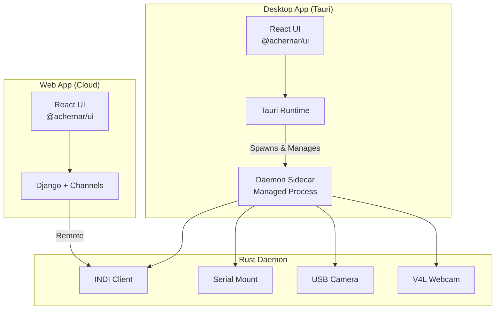

# Achernar - Unified Astronomy Imaging and Control System

**A comprehensive platform for amateur and professional astronomers combining offline-first design with cloud capabilities.**

## 🌟 Features

- **Hardware Control**: Direct interfacing with cameras, mounts, and focusers via INDI, ASCOM, USB
- **AI-Enhanced Imaging**: ONNX-based focus scoring, cloud detection, and intelligent recommendations
- **Offline-First**: Full functionality without internet via local daemon
- **Cloud Sync**: Automatic session synchronization when online
- **Cross-Platform**: Desktop app (Tauri) and web interface sharing the same UI components

## 🏗️ Architecture



## 📁 Repository Structure

```
achernar.tech/
├── packages/
│   ├── ui/              # Shared React components (@achernar/ui)
│   ├── web/             # Cloud frontend (Vite + React)
│   └── desktop/         # Desktop app (Tauri)
├── achernar-daemon/     # Rust daemon with hardware interfacing
├── achernar_backend/    # Django backend (Channels + Celery)
├── docker-compose.yml   # Development environment
└── pnpm-workspace.yaml  # Monorepo configuration
```

## 🚀 Quick Start

### Prerequisites

- **Node.js** 18+ and **pnpm** 8+
- **Python** 3.11+
- **Rust** 1.70+
- **Docker** and **Docker Compose**
- **PostgreSQL** 15+ (or use Docker)

### Development Setup

1. **Clone the repository**
   ```bash
   git clone https://github.com/yourusername/archenar.tech.git
   cd archenar.tech
   ```

2. **Install dependencies**
   ```bash
   # Install pnpm if needed
   npm install -g pnpm

   # Install all workspace packages
   pnpm install

   # Install Python dependencies
   pip install -r requirements.txt
   ```

3. **Set up environment**
   ```bash
   cp .env.example .env
   # Edit .env with your configuration
   ```

4. **Start services with Docker**
   ```bash
   docker-compose up -d
   ```

5. **Run database migrations**
   ```bash
   python manage.py migrate
   ```

6. **Access the applications**
   - Web frontend: http://localhost:5173
   - Django backend: http://localhost:8000
   - Django admin: http://localhost:8000/admin

### Building the Daemon

```bash
cd achernar-daemon
cargo build --release
```

### Building the Desktop App

```bash
cd packages/desktop
pnpm tauri build
```

## 🛠️ Technology Stack

### Frontend
- **React 18** with TypeScript
- **Vite** for fast HMR
- **TanStack Query** for data fetching
- **d3.js** for visualizations
- **fits.js** for FITS file handling

### Backend
- **Django 4.2** with REST Framework
- **Channels** for WebSocket support
- **Celery** for background tasks
- **PostgreSQL** with PostGIS
- **Redis** for caching and message broker

### Daemon (Rust)
- **Axum** web framework
- **INDI** protocol client
- **USB** camera support (rusb)
- **Serial** mount control
- **ONNX Runtime** for AI inference

### Desktop App
- **Tauri 2.0**
- **React** (shared from `@achernar/ui`)
- **Rust** backend

## 📚 Documentation

- [Development Guide](./DEVELOPMENT.md)
- [API Documentation](./docs/API.md)
- [Hardware Setup](./docs/HARDWARE.md)
- [Deployment Guide](./docs/DEPLOYMENT.md)

## 🤝 Contributing

Contributions are welcome! Please see [CONTRIBUTING.md](./CONTRIBUTING.md) for details.

## 📄 License

This project is licensed under the MIT License - see [LICENSE](./LICENSE) for details.

## 🙏 Acknowledgments

- INDI Protocol maintainers
- The astronomy amateur community
- All open-source contributors

---

**Built with ❤️ for the astronomy community**
